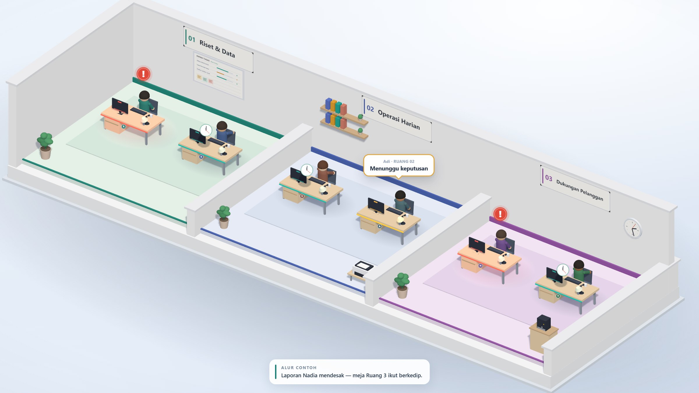

# Kantor Isometrik 3D + Otak AI

Diorama kantor isometrik dengan Three.js: **3 ruangan, 6 agen di mejanya**, jam tugas yang berjalan saat mengetik, gelembung **“Menunggu keputusan”** saat laporan masuk, tanda **!** dan **meja berkedip** saat laporan mendesak.

Setiap agen punya **otak AI sendiri** lewat server lokal: DeepSeek, Gemini, dan GPT. Tidak ada nominal uang di mana pun — status, nama, tugas, dan waktu tugas saja.



## Online

Demo publik: **https://mercurybull27-hub.github.io/kantor-isometrik-3d/**

Halaman GitHub Pages bersifat statis. Scene, mode contoh, dan **otak lokal** berjalan di browser, tetapi panggilan model asli (DeepSeek/Gemini/GPT) memerlukan server Node. Untuk menjalankan server AI secara online, deploy repo ini ke Render (butuh akun Render, login sekali):

[Deploy ke Render](https://render.com/deploy?repo=https://github.com/mercurybull27-hub/kantor-isometrik-3d)

Render membaca `render.yaml`, lalu meminta kunci API. Tanpa kunci, server online tetap berjalan dalam mode simulasi.

## Menjalankan

Butuh **Node.js 18+** (tanpa `npm install`, tanpa dependensi).

**Windows:** klik dua kali `start.bat` → server jalan di `http://localhost:8000` dan browser terbuka.

Manual:

```bash
cd kantor-isometrik
node server.mjs
# buka http://localhost:8000
```

Three.js r160 disertakan di `vendor/`, jadi scene tetap jalan tanpa internet. Membuka `index.html` lewat `file://` akan menampilkan petunjuk server.

## Otak AI per agen

| Agen | Ruangan | Otak |
| --- | --- | --- |
| Rani | Riset & Data | DeepSeek · `deepseek-chat` |
| Bima | Riset & Data | Gemini · `gemini-2.5-flash` |
| Sinta | Operasi Harian | GPT · `gpt-4o-mini` |
| Adi | Operasi Harian | DeepSeek · `deepseek-chat` |
| Nadia | Dukungan Pelanggan | Gemini · `gemini-2.5-flash` |
| Yoga | Dukungan Pelanggan | GPT · `gpt-4o-mini` |

Tiap beberapa detik masing-masing agen mengirim konteks (status, durasi tugas, jumlah laporan lain) ke modelnya. Model membalas JSON berisi status berikutnya dan catatan singkat. Server memvalidasi, menyaring nominal uang, lalu meneruskannya ke scene.

### Mengisi kunci API

1. Buka `.env` di folder ini (sudah dibuat dari `.env.example`). Cara cepat: klik dua kali `isi-kunci.bat`.
2. Isi kunci yang Anda punya — cukup salah satu, atau ketiganya:

```env
DEEPSEEK_API_KEY=...
GEMINI_API_KEY=...
OPENAI_API_KEY=...
```

3. Simpan. Server membaca ulang `.env` pada setiap permintaan, jadi tidak perlu restart. Muat ulang halaman agar label “siap / tanpa kunci” ikut berubah.

Kunci hanya dibaca di server (`server.mjs`), tidak pernah dikirim ke browser, tidak masuk log, dan `.env` sudah dikecualikan dari git. Jangan menempelkan kunci di chat.

Model bisa diganti lewat `DEEPSEEK_MODEL`, `GEMINI_MODEL`, `OPENAI_MODEL`. Untuk gateway kompatibel OpenAI, isi `OPENAI_BASE_URL` / `DEEPSEEK_BASE_URL`.

### Tanpa kunci / saat model gagal

Otak AI tetap berjalan dalam **mode simulasi** (aturan lokal) supaya demo tidak berhenti. Label di panel dan caption akan menunjukkan `simulasi` atau `cadangan`. Tombol **Otak AI** mematikan/menyalakan seluruh lapisan ini; saat mati, scene memakai mode data contoh atau mode langsung.

## Kontrol

| Aksi | Fungsi |
| --- | --- |
| Geser (drag) | Memutar kamera isometrik |
| Scroll | Zoom |
| Klik agen / meja | Ubah status: mengetik → menunggu keputusan → mendesak |
| Klik dua kali | Kembalikan posisi kamera |
| `1`–`6` | Ubah status agen sesuai nomor meja |
| `A` | Otak AI on/off |
| `S` | Mode data contoh on/off (mematikan otak AI) |
| `R` | Ulangi alur contoh dari awal |
| `C` | Kamera bergerak (drift halus) on/off |
| `H` / **Mode rekam** | Sembunyikan panel; hanya scene + caption |
| `Esc` | Keluar dari mode rekam |

## Status visual

- **Mengetik** — jam tugas melayang di atas meja, jarum berputar, tangan agen mengetik, strip meja hijau toska.
- **Menunggu keputusan** — gelembung putih bertepi kuning “Menunggu keputusan” di atas agen; nama agen + model yang memutuskan.
- **Mendesak** — tanda **!** merah, permukaan meja berkedip merah, pendar lantai, lampu meja berkedip.

## Mode data contoh (rekaman)

Tanpa AI, tombol **Sampel** menjalankan alur tetap 34 detik yang bisa diulang persis: semua mengetik → laporan masuk → eskalasi mendesak → kembali mengetik.

1. nyalakan **Sampel**, klik **Ulangi**;
2. klik **Mode rekam** (panel hilang, caption tetap);
3. rekam 16:9 (1920×1080 disarankan), tekan `Esc` setelah selesai.

Matikan **Kamera bergerak** untuk bidikan statis.

## Menyesuaikan

- `app.js` → `ROOMS`, `AGENT_DATA`, `SCRIPT`, `LOOP_LEN`, warna status di `COL`.
- `server.mjs` → `AGENTS` (persona untuk prompt), `ASSIGNMENTS` (model per agen), `buildMessages()` (gaya keputusan).
- `server.mjs` → `PROVIDER_DEFS` untuk model/endpoint default.

## Struktur

```
index.html                   HUD, caption, gelembung HTML, gaya
app.js                       scene Three.js, agen, jam tugas, otak AI
server.mjs                   server statis + perantara model (tanpa dependensi)
.env.example                 contoh konfigurasi kunci/model
isi-kunci.bat                buka .env di Notepad (Windows)
vendor/three.module.min.js   Three.js r160 (MIT)
```

Gelembung status memakai HTML/CSS yang ditempel ke posisi 3D agar teks tetap tajam di resolusi rekaman berapa pun.
